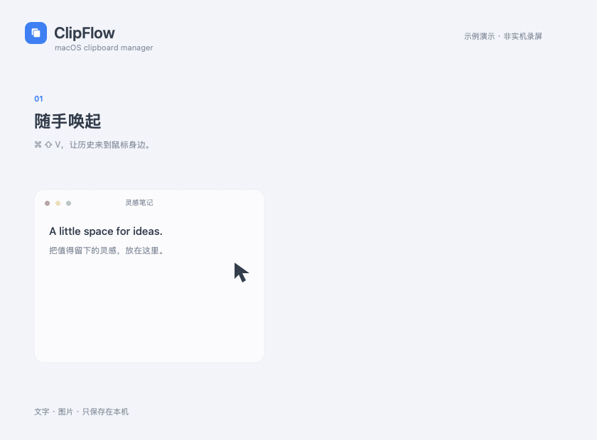

# ClipFlow

轻量的 macOS 原生剪贴板管理器。用 **⌘⇧V**（可自定义）在鼠标附近唤起历史，搜索并粘贴文字或图片。

基于 SwiftUI + AppKit，无第三方运行时依赖。当前版本：**0.7.0（MVP）**。

## 功能演示



> 使用示例数据制作的示意动画，非实机录屏。以 25 帧/秒连续展示唤起、逐字搜索、固定、图片粘贴、删除、清空和窗口拖动。

## 功能

- 真实系统剪贴板监听，支持文本和图片，自动去重与本地持久化。
- 搜索、固定、删除、清空未固定项，支持暂停记录。
- 点击记录恢复原应用并粘贴，图片显示缩略图。
- 鼠标位置锚定、多屏边界限制、顶部拖动。
- 系统深浅色半透明材质、悬停高亮和开关动画，适配“减少动态效果”。

## 构建与运行

需要 macOS 14+、Swift 6.0+（以 Swift 5 语言模式编译）、Apple Command Line Tools 或 Xcode。

```sh
./scripts/build.sh
open dist/ClipFlow.app
```

应用驻留菜单栏，点击 **⌘V** 图标可打开面板或退出。默认按 **⌘⇧V** 打开，Esc 或点击外部关闭。按住顶部标题区域拖动；下一次唤起仍锚定鼠标位置。

自动粘贴需要在“系统设置 → 隐私与安全性 → 辅助功能”允许 ClipFlow。未授权时记录已复制到系统剪贴板，可以手动 ⌘V。图片需粘贴到接受图片的应用，例如备忘录。无需屏幕录制权限。

### 自定义唤起快捷键

点击菜单栏 **⌘V → 快捷键设置…**，点击录入区域，再按下新组合键。注册成功后立即保存，重启仍然有效，面板和菜单会显示当前快捷键。可点击“恢复默认 ⌘⇧V”。

组合键至少包含 Command、Control 或 Option；Esc 取消录入。为避免影响日常编辑，单独的 ⌘C、⌘V 等常用组合不接受，请增加修饰键。注册冲突会提示重选；部分系统组合会被 macOS 优先截获，无法录入。录入期间暂停全局唤起，取消、关闭窗口或切换应用后恢复原快捷键。即使快捷键不可用，也可通过菜单栏打开面板和设置。

宽度默认 380 pt，可配置为 320–520 pt（重启生效）：

```sh
defaults write local.clipflow.app panelWidth -float 400
```

## 隐私与限制

历史保存在 `~/Library/Application Support/ClipFlow/history.json`，为明文 JSON（图片为内嵌 PNG）。应用没有联网或上传逻辑。敏感内容可能进入历史，请在复制前暂停记录；常见 concealed/transient/generated 标记会被过滤，但并非所有密码应用都提供这些标记。

- 每 0.5 秒检查剪贴板，快速连续复制可能遗漏中间项。
- 文本上限 1 MB，图片上限 20 MB；最多 200 条未固定项，未固定图片合计约 100 MB。固定项不受总量限制。
- 暂停记录不会清除已有数据；清空保留固定项，固定项需单独删除。
- 支持图片内容，不保证支持 Finder 图片文件复制；不支持任意文件历史。
- 暂无登录启动、应用排除列表或加密存储。
- 使用系统 ultraThinMaterial 实现 Liquid Glass 灵感外观，不依赖最新 Liquid Glass API。

## 工程结构

```text
Sources/ClipFlow/   模型、剪贴板存储、SwiftUI 视图、AppKit 窗口和入口
Resources/         应用元数据
scripts/build.sh   Release 构建、打包及签名
docs/             验收说明
```

构建产物在 `dist/`，已从 Git 排除。默认采用本地临时签名；可通过 `CLIPFLOW_SIGN_IDENTITY` 指定签名身份。对外分发前需自行完成 Developer ID 签名及公证。

参见 [贡献指南](CONTRIBUTING.md)、[手动验收](docs/TESTING.md) 和 [更新记录](CHANGELOG.md)。目前未设置开源许可证，公开仓库不代表授予开源使用许可；发布前请由项目作者选择许可证。

## 重新生成演示动图

演示使用合成数据，不读取系统剪贴板或录制桌面。需要 Swift 和 `ffmpeg`：

```sh
./scripts/generate-demo.sh
```

输出为 `docs/media/demo.gif`：840 × 620、25 fps、16.4 秒，采用全局调色板和差分压缩。
